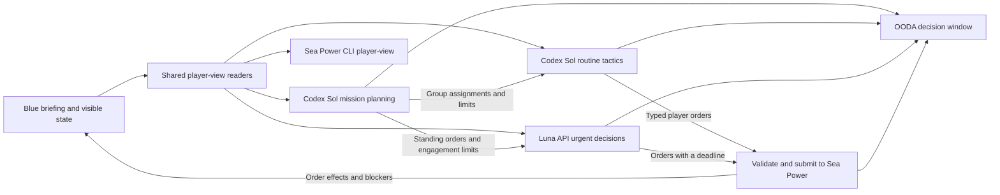

# OODA: four-hour plan for single-scenario AI

Load an unmodified vanilla scenario, let Codex Sol command the authored Blue side, and watch it issue normal player orders. Sol handles mission planning and routine tactics through the ChatGPT subscription. Reserve the Luna API for urgent decisions with a short window to act. C# supplies the player's view, checks decisions, and submits orders through Sea Power. The game runs Red, mission scripts, victory conditions, and unit behavior such as steering, dogfighting, and weapons execution.

## Where the models make decisions

| Layer | What the model decides | When it runs |
| --- | --- | --- |
| Operational, Codex `gpt-6.1-sol` using ChatGPT sign-in | Interpret the briefing, choose priorities, and assign groups. Cardiff might continue the patrol while Alacrity covers the approach. | At mission start and when a change to the objective or an assignment calls for a new plan. Coalesce related events. |
| Routine tactical, Codex `gpt-6.1-sol` | Choose the next player order for each assigned group. Sol might set a waypoint, reposition a screen, or wait for a track update. | When a plan is accepted or a meaningful change warrants a new order. Check roughly every 60 simulated seconds and batch active groups. |
| Urgent tactical, OpenAI Decisions `gpt-6-luna` | Weigh tradeoffs that depend on the situation, such as whether a badly threatened ship should launch a limited anti-ship salvo while it still can or preserve its missiles and try to survive. | On an urgent event the player can observe, when there is a meaningful choice and enough time to act on the answer. |

Run planning through the locally signed-in `codex exec` CLI. Use `--model gpt-6.1-sol`, `--output-schema`, and `--output-last-message`. Launch it from an empty working directory and pass the Blue snapshot over stdin. Use an ephemeral read-only run with shell, web search, apps, plugins, and MCP servers disabled. Keep ChatGPT credentials inside Codex and keep API credentials out of its subprocess environment. A live smoke test on this PC returned the expected assignment as JSON under ChatGPT sign-in. If another machine needs sign-in, use `codex login` or `codex login --device-auth`. This is a local playtest workflow. [Codex authentication](https://learn.chatgpt.com/docs/auth?surface=cli) · [Codex CLI options](https://learn.chatgpt.com/docs/developer-commands)

Use `POST /v1/decisions` for Luna with a choice question built from the eligible actions. Keep the Luna credential local to that path. The current Codex mock uses a structured reply and adds a short explanation. The Decisions endpoint returns the chosen option and its confidence. Keep the cap of six calls per scenario and count requests at dispatch. Coalesce repeated reports about the same inbound salvo. If the cap is reached or the API reports a quota error, Sol keeps handling routine orders and Sea Power's defenses remain active. [OpenAI Decisions](https://developers.openai.com/api/reference/resources/decisions/methods/create)

- **Operational response.** Sol returns an objective and a bounded list of assignments with `groupId`, `task`, `destinationId`, and `reason`. Start with `Transit`, `Screen`, and `Hold`. C# checks that each group is commandable, appears at most once, and has a usable destination.
- **Routine tactical response.** Sol returns at most one order per group with `groupId`, `action`, `destinationId`, and `reason`. Start with `SetWaypoint`, `Wait`, and `RequestReplan`. C# resolves the destination and checks it against the assignment. Add `SetSpeed` after waypoint parity passes.
- **Urgent tactical response.** Luna returns one `optionId` and a short `reason`. OODA provides the available options with their prerequisites and verifies the selected option again before execution.

Give the model room to interpret the brief and make tradeoffs. A small scenario profile can supply IDs for map locations already named in the briefing when extracting them live would take too long. It cannot supply a route to follow, the enemy roster, future triggers, or a script of correct decisions. The model receives the current assignments and last order results on each call; a compact snapshot is enough for the first build. Skip a local planner, general playbook engine, or tactical scoring system in this sprint.

Use the [decision prompts](prompts/README.md) as the first runtime instructions. The OODA mod embeds them and injects the current player-facing briefing and scoped snapshot when composing a request. The [problem solving guide](decision-guide.md) defines situations and tests that transfer between missions. Use the [installed game mechanics](game-mechanics.md) to implement the order adapter.

## Keep the player side and validate the orders

Start **AI control** automatically when a scenario has an authored, controllable player task force and normal fog of war. **Take control** stops new orders for the current mission. Keep accepted orders visible and editable. Start a fresh decision session after mission reload. [Observer spectator mode](../../src/Observer/SpectatorMode.cs)

For vanilla navigation, use public chart destinations and validate each waypoint against navigable water and the unit's current route. Start with the stock *Armilla Patrol: Britain (1980)* scenario. Its English briefing requires Cardiff and Alacrity to arrive at Bahrain by 20:30 after transiting along the Saudi coast. It directs the player to avoid escalation. Track arrival for both ships and use the mission clock for the deadline. Keep a good native route in place and flag a coverage or timing problem when one appears.

Trace a manual surface waypoint to the native handler, including how it appends or replaces the route, then call the same command path from OODA on the game thread. The [Sea Power manual](https://shared.akamai.steamstatic.com/store_item_assets/steam/apps/1286220/manuals/9d1acaf69b93dc4b95044ce5894476713ea1bb0e/SeaPower_Manual_en003.pdf) describes the player controls; compare the actual route and unit response in the installed build. Preserve existing authored orders until OODA has a valid replacement for a group. Defer engagement, carrier operations, and other commands until their player-side validation is verified.

Keep requests off the game thread. An urgent request can run while a Sol request is in flight. Recheck scenario generation, plan revision, current commandability, destination, and pause state before applying a response. Ignore a response made stale by a new plan, manual takeover, or unload. Deduplicate equivalent waypoints. On a failed Sol request, keep the last accepted orders active and show why the AI is waiting.

## Urgent tactical judgment

Sea Power handles routine defenses, including chaff. Start with a surface ship at serious risk of being lost that still has anti-ship missiles and an identified target it can engage. Give Luna the evidence Blue has for that risk, including the ship's damage, remaining defenses, incoming tracks and their uncertainty, the target's value to the mission, and whether an outgoing salvo would duplicate fire already committed. Let Luna weigh the chance of losing the missiles aboard against the value of saving them for a better shot. A threat or damage threshold can flag the situation for review. Luna makes the judgment from the full picture.

Offer one bounded salvo from the threatened ship at a currently authorized target and the option to hold fire. Verify that the native order targets that ship alone because the ordinary weapon path can forward orders to formation members. OODA checks the rules of engagement, launcher readiness, and native firing constraints before offering the shot and again before executing it. Reserve the request for cases where both choices are plausible. Set the deadline from the observed threat, native launch delay, and current time compression. Native defenses keep running while Luna replies. If time runs out or the request fails, keep the current defense and hold the salvo. Record the decision, deadline, actual latency, and whether the salvo was queued or launched.

For a unit that can fire before diving, offer that sequence when the native commands allow the shot and it leaves time to dive. Use the unit's standing evasion order when the shot is unavailable or the response misses the deadline. Add this case after verifying the surface salvo and timing.

## Share the player view with the CLI

Reuse the Game Bridge's in-game clock and unit readers where they match the player view. Extract small C# readers that OODA can call in-process and that Game Bridge can expose through a new `seapower-cli player-view --json` command. OODA calls the readers directly. Start with the briefing, objective updates, commandable units, and current orders. Add displayed contacts after verifying the source against Blue's tactical map. Use the CLI's existing query and snapshot-diff features to compare the player view across a run. [Game Bridge unit reader](../../src/SeaPower.GameBridge/UnitSnapshot.cs) · [Sea Power CLI](../seapower-cli/README.md)

The game binds each call to the authored player task force and current mission. Confirm ownership independently of the native commandability property, which can honor a debug override. Use the same plotting table and visibility filter as the tactical map. Preserve the displayed posture, identification, position or bearing estimate, freshness, and source where available. Manual posture and positive identification are separate facts. Keep briefed reports separate from live tracks. A protected merchant may be visible and part of the objective without accepting Blue's orders. Resolve lookups within the same view so a guessed ID reveals nothing about a hidden unit. Verify that an undetected ship is absent from prompts, tool results, and the decision window. Check that acquired and lost tracks match the tactical display, and that changing a track ID alone does not change how the AI treats it.

Send Sol a compact player-view snapshot with each decision and let it request details through a small set of read-only tools. Start with `get_player_briefing`, `get_owned_unit(unitId)`, and `get_current_orders(unitId)`. Add `get_visible_contacts` and `get_flight_deck(shipId)` when their data paths are verified. Use `get_owned_unit` for the first live tool round trip. `codex exec` can return a structured data request. OODA runs the reader and feeds the result back in one follow-up pass. For urgent decisions, OODA calls those same readers before sending Luna a complete snapshot and choice list in one request.

## Watch decisions in the game

Build one native **OODA Decisions** window using the shared window and tab controls. **Mission Command** shows Sol's reading of the objective, current plan, group assignments, and the reason for each replan. Each ship tab shows its assignment, what Sol or Luna saw, the order and its short explanation, and whether the game accepted it. A ship following a formation leader shows the shared decision and the order recipient. [Shared UI](../../src/SeaPower.SharedUi/README.md)

Use the same bounded event history for the window and `Player.log`. Show timestamps, model and provider, tool name and result, and a small Luna call counter. Record when a response is pending or stale and, where observable, when the game starts following the order. The window reads existing observations and decisions, so opening tabs costs no model calls. Use short decision explanations returned in the schemas. Include **Take control** in the window so the demo shows both decision-making and handoff.

## Aircraft with Deck Tweaks

Assume Deck Tweaks is installed for carrier and airbase operations. Player-side aircraft orders must go through the player flight deck path so OODA sees the same queue and preparation rules as a person. Deck Tweaks tracks refueling and stores per aircraft, and the batch launches when every member is ready. Preparation time depends on remaining fuel and stores, loadout changes, crew allocation, and stock. Use the live deck estimate and readiness, and distinguish **preparing**, **awaiting crew or stock**, **ready**, **airborne**, and **unloading after abort**. The ready estimate changes with crew allocation and does not promise a launch time. [Deck Tweaks preparation](../deck-tweaks/README.md#preparation)

Sol plans air cover and strike windows around deck readiness and recovery margins. It chooses player orders such as queueing a flight, keeping a partly prepared loadout, changing it when the mission warrants the delay, or waiting. An abort uses spare crew to unload stores before the aircraft return to the hangar. A cancel resumes from the stores still aboard. Show queue status and the last aircraft decision on the host ship's tab. Verify one prepare, launch, recover, and prepare-again cycle with Deck Tweaks enabled before adding a carrier mission.

## Four one-hour sprints

Treat each hour as a small sprint with a demo and use what it reveals to pick the next hour's work. This is the starting order.

| Sprint | Runnable checkpoint | What to show |
| --- | --- | --- |
| 1 | Load *Armilla Patrol*, expose the shared Blue snapshot through the CLI, and prove waypoint parity. | Inspect what Blue can see, compare a player waypoint to an adapter waypoint, and show takeover. |
| 2 | Use the draft prompts to plan from the live briefing, run one scoped tool lookup, and issue the first validated Sol waypoint. | A mission assignment leads to visible ship movement. The decision trace cites a briefing constraint or current observation. |
| 3 | Open the native decisions window with Mission Command and ship tabs. | Follow a decision from plan to ship order and game result, then take control from the window. |
| 4 | Re-run the vanilla Sol demo and exercise the last-salvo decision in a controlled encounter. | Show one live Luna response if access is available. Verify that a delayed reply leaves the salvo unfired and native defenses running. |

Keep the vanilla Sol run and decision window as the surface demo. Use a separate repeatable encounter to exercise the urgent trigger without depending on an attack in *Armilla Patrol*. Speed control and aircraft execution can follow. *Hormuz* is the next escort and identification case. *Action in the Gulf of Sidra* is a candidate for carrier operations once the Deck Tweaks cycle works.

Expand the Game Bridge actions to cover native player controls, including force, formation, and unit Standing Orders. Use the game's route display for waypoint orders and reserve OODA's map annotations for objectives, search areas, and mission reference points. Expose the annotations in the player view so the player and subagents can refer to the plan.

The architecture keeps three ideas from the research: [SHOP2](https://www.cs.umd.edu/~nau/papers/nau2003shop2.pdf) separates a mission from the tasks that accomplish it; [Goal-Driven Autonomy in StarCraft](https://cdn.aaai.org/ojs/12401/12401-52-15929-1-2-20201228.pdf) revisits goals when expectations fail; [SayCan](https://arxiv.org/abs/2204.01691) ties model choices to actions the system can execute. The sprint uses those boundaries and leaves larger planning machinery for later.
